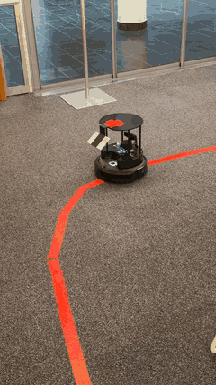
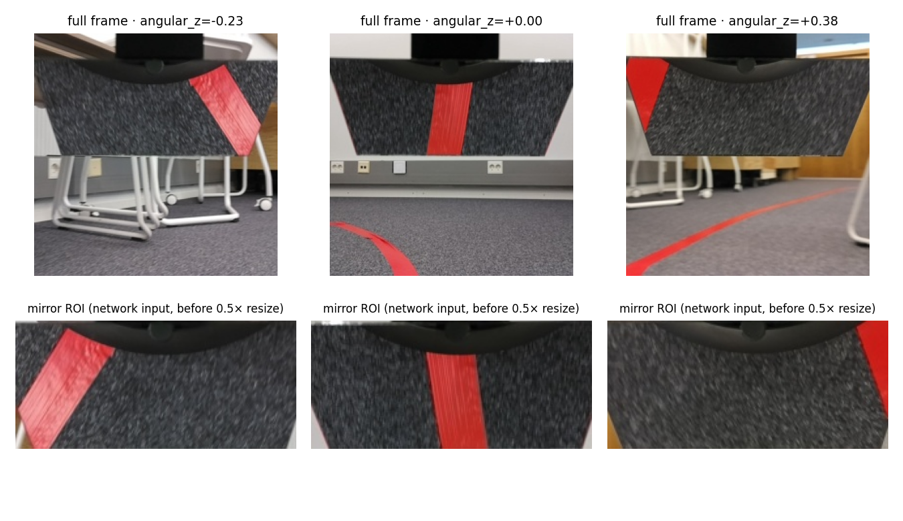
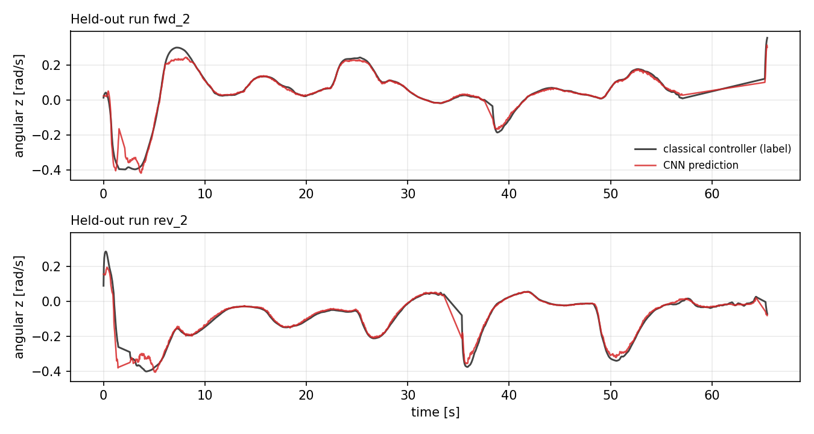
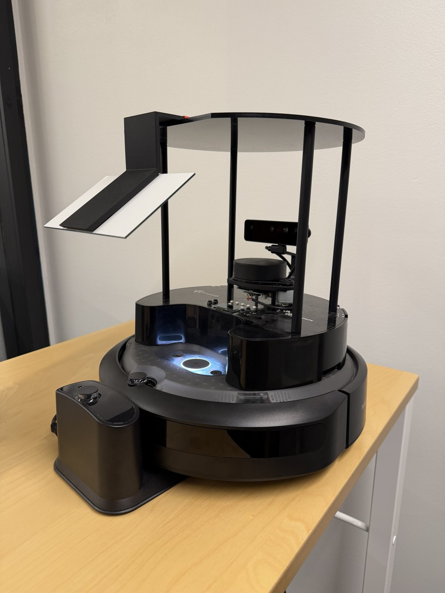

# TurtleBot 4 Lane Following — learning a line follower from a mirror camera

This is a project made as a demo for an upcoming Robot Learning Labs course at Tampere University. A [TurtleBot 4](https://turtlebot.github.io/turtlebot4-user-manual/) follows a red tape track using a **small CNN (~0.7 MB)** trained on a dataset I recorded myself. The OAK-D camera looks at the floor through a **3D-printed mirror bracket**, which removes the camera's forward blind zone. The network is trained by imitation: it learns to reproduce the steering of a classical HSV + proportional controller from the mirror image alone.

<p align="center">
  
</p>

<p align="center"><em>The robot following the tape through a corner (<a href="docs/videos/demo.mp4">higher-quality clip</a>).</em></p>



_Top: full OAK-D frame — the black trapezoid is the mirror, the lower part is the direct view. Bottom: the mirror region of interest (ROI) that is cropped, flipped and fed to the network._

## How it works

```
 OAK-D preview image (250×250)
        │  crop mirror ROI (rows 11–50 %, cols 8–94 %) and flip left-right
        ▼
 98×215 BGR crop ──► HSV red mask ──► red-pixel count ──► TRACK / SEARCH state machine
        │
        │  resize 0.5× → 49×108 RGB, /255
        ▼
   LaneNet CNN (ONNX Runtime, CPU) ──► angular_z [rad/s] ──► /cmd_vel
```

1. **Collect** – `tb4_record` runs the classical controller (red-tape HSV threshold → centroid → proportional steering, EMA-smoothed) and logs every control decision together with the exact frame that produced it, so image and label are perfectly in sync.
2. **Train** – `training/train.py` fits `LaneNet` (4 stride-2 conv blocks → 64-unit FC → 1 output) on the cropped frames with a standardised MSE loss, brightness/contrast augmentation, AdamW and cosine decay (20 epochs).
3. **Export** – `training/export_onnx.py` converts the best checkpoint to ONNX and checks parity against PyTorch.
4. **Drive** – the `tb4_drive` package (`ros2_driving/`) has two self-contained driving nodes selected by one launch file: `classical_controller` (the HSV + proportional controller on its own) and `ml_controller` (runs the ONNX model on every frame). The HSV red-pixel count is still used as a _line present / lost_ gate: the robot drives with the network's steering while tracking, and rotates in place towards the last turn direction to re-acquire the line when it's lost. Both nodes have a watchdog that stops the robot if images stop arriving, and both start in **dry-run mode** (`drive:=false`) until you ask them to move.

## Results

Evaluated on two complete runs held out from training (`fwd_2`, `rev_2`; 3 529 frames), using the exported ONNX model:

|                                      | RMSE [rad/s] | MAE [rad/s] |       R² |
| ------------------------------------ | -----------: | ----------: | -------: |
| Predict the training mean (baseline) |        0.149 |           – |        0 |
| **LaneNet**                          |    **0.021** |   **0.010** | **0.98** |

Per run: `fwd_2` RMSE 0.020, `rev_2` RMSE 0.021 (labels span ≈ −0.40 … +0.36 rad/s).



> **What this does and doesn't show.** The validation labels are the _classical controller's_ commands, so this measures how faithfully the CNN clones that controller from the mirror image, not an independent measure of driving quality. The largest deviations are on the sharpest corners, where the network under-steers slightly. The robot completes the track with the learned controller; a quantitative closed-loop comparison (lap time, line-offset, interventions) against the classical controller is still to do.

**Where things run:** the TurtleBot only streams camera images over ROS 2 and executes `/cmd_vel`. The recorder and both driving nodes run on a separate computer (a VM in my setup) on the same network, and the model runs there on CPU through ONNX Runtime. The ML node logs its per-frame processing time (`infer=… ms`).

## Repository layout

```
ros2_datacol/src/tb4_record/   ROS 2 package: classical controller + dataset recorder (tb4_datacol)
ros2_driving/src/tb4_drive/    ROS 2 package for driving
    launch/drive.launch.py       driver: controller:=classical | ml
    tb4_drive/classical_controller.py   HSV red-tape detection + proportional steering
    tb4_drive/ml_controller.py          ONNX CNN steering + HSV line-lost gate
training/                 train.py, export_onnx.py
models/                   lane_best.onnx (+ lane_best.json normalisation/input metadata), lane_best.pt
data/                     dataset instructions and a 24-frame sample
docs/images/              figures used in this README
```

## Hardware

- TurtleBot 4 w/ ROS 2 Jazzy
- OAK-D camera
- 3D-printed mirror bracket holding a mirror at ≈ 25–35° in front of the camera so it sees the floor just ahead of the robot (STL file available in hardware folder)
- Red tape track on carpet

<p align="center">
  
</p>

<p align="center"><em>The robot with the 3D-printed mirror arm in front of the camera.</em></p>

## Usage

### 1. Record data (ROS 2 Jazzy, on a computer connected to the robot)

```bash
cd ros2_datacol && colcon build --packages-select tb4_record && source install/setup.bash
ros2 run tb4_record tb4_datacol --ros-args -p output_dir:=~/lane_dataset -p run_tag:=fwd_1
```

The robot follows the line with the classical controller while saving frames and labels (see [`data/README.md`](data/README.md) for the format and how to get the dataset I recorded).

### 2. Train and export (any machine with PyTorch; uses Apple MPS if available)

```bash
pip install -r requirements.txt
LANE_DATASET=data/lane_dataset python training/train.py     # writes models/lane_best.pt
python training/export_onnx.py                              # writes models/lane_best.onnx + .json
```

### 3. Drive the robot (classical or learned controller)

```bash
pip install onnxruntime                       # only needed for the ML controller
cd ros2_driving && colcon build --symlink-install && source install/setup.bash

# dry run: logs what it would do, publishes nothing
ros2 launch tb4_drive drive.launch.py controller:=ml

# drive with the learned controller / the classical controller
ros2 launch tb4_drive drive.launch.py controller:=ml drive:=true linear_speed:=0.10
ros2 launch tb4_drive drive.launch.py controller:=classical drive:=true
```

Launch arguments: `controller` (`classical` | `ml`), `drive`, `linear_speed`, `model_path` (ML only; defaults to `models/lane_best.onnx` in the repo, found via `--symlink-install`), `image_topic`, `cmd_vel_topic`. The nodes can also be started directly, e.g. `ros2 run tb4_drive ml_controller --ros-args -p drive:=true`.

Node defaults: the classical controller drives at 0.15 m/s (the speed the dataset was recorded at), the ML controller at 0.10 m/s. Other parameters: `p_gain`, `alpha`, `rotate_speed` (classical); `max_angular`, `lost_grace`, `reacquire_frames`, `match_jpeg` (ML). With `match_jpeg:=true` the frame is JPEG-encoded and decoded before inference so its statistics match the JPEG-saved training images. The classical node also publishes an annotated `~/debug_image`.

## Known issues, limitations and next steps

- Red thresholding needs some more optimization and tweaking; currently bright lights reflecting off the tape can make the robot lose the line.
- One track, one lighting setup, one robot; no domain randomisation yet.
- Pure behaviour cloning of a classical controller can't outperform it and doesn't see its own mistakes — DAgger-style relabelling of the learned policy's trajectories is the obvious next step.
- The red-tape HSV gate is still in the loop for line-lost detection; the network only does steering.
- Full frames are recorded to enable look-ahead models (mirror for near view + lower frame for far view).
- Closed-loop evaluation.

## License

Apache-2.0 — see [LICENSE](LICENSE).
